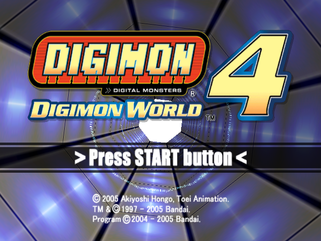

# Digimon World 4 — Recomp

**English** · [Português (Brasil)](README.pt-BR.md)

Experimental **static recompilation of Digimon World 4 (original Xbox, 2005)** into a native
x86-64 program (Linux today; Windows and macOS are planned), built on [xboxrecomp](https://github.com/sp00nznet/xboxrecomp).
The game's own code is translated to C once and compiled natively; the xboxrecomp runtime and this
project's code replace the Xbox kernel, GPU, audio and input. No emulator.

> This repository contains **no game code and no game data**. You need your own, legally obtained
> copy of Digimon World 4 for the Xbox (NTSC-U). The C code is generated on your machine from your
> `default.xbe` and is never committed.



## Status

Playable from boot through the first stage at 60 fps on the test machine (CachyOS, NVIDIA).
Early and experimental: expect bugs.

| Milestone | |
|---|---|
| Pipeline: 23,472 functions lifted, 0 translation errors, 2.25 M lines of C | ✅ |
| Native Linux host (SDL2, POSIX threads), case-insensitive game file access | ✅ |
| Boot, intro movies (CRI Sofdec), title screen | ✅ |
| Menus, Digimon creation, saving and loading | ✅ |
| OpenGL 3.3 renderer with texture cache: 60 fps in the lobby (CPU renderer ~3 fps, kept as the reference) | ✅ |
| Controller (XInput-style pads) and keyboard | ✅ |
| Lobby, tutorial and first stage playable | ✅ |
| Later stages, bosses, the rest of the game | ⬜ not tested yet |
| Multiplayer (2–4 players) | ⬜ not tested yet |
| Higher internal resolution, widescreen, key remapping | ⬜ not implemented |
| Vulkan renderer | 🔧 in development |
| Windows and macOS | ⬜ planned, not started |
| Steam Deck | ⬜ not tested |

Full details and the list of what is still missing: [STATUS.md](STATUS.md) (Portuguese).

### Known issues

- Skipping the intro movie with START sometimes makes the game quit (about 1 run in 4 in automated
  tests). Start it again; letting the movie play avoids it.
- Automatic texture-coordinate generation (reflections, shine effects) is not implemented; some
  objects may look flat.
- Tested on a single machine. Other GPUs, drivers and distributions are untested.

## Playing a release

One download, nothing to install:

1. Download `DigimonWorld4-Recomp-<version>-x86_64.AppImage` from the [releases page](https://github.com/lorransouzaaguiar/Digimon-World-4-Recomp/releases).
2. Make it executable and open it: `chmod +x DigimonWorld4-Recomp-*.AppImage`, then double-click
   (or `./DigimonWorld4-Recomp-*.AppImage`).
3. On the **Play** screen, choose the image (`.iso`) of your own Digimon World 4 disc, or a folder
   with the disc already extracted. The launcher copies the four game files it needs.
4. Click **PLAY**.

The AppImage carries the launcher (with Qt), the recompiled game and the libraries it needs (SDL2,
libepoxy, libcrypto). It does **not** carry the game data: that comes from your disc.

Requirements: Linux x86-64 with glibc 2.38 or newer (Ubuntu 24.04+, Fedora 39+, Arch, SteamOS 3.6+)
and a GPU with a working OpenGL 3.3 driver. If the AppImage does not start because FUSE is missing,
run it with `--appimage-extract-and-run`, or use the `.tar.gz` package (same content, unpack and run
`./DigimonWorld4-Recomp`).

Saves, settings and logs live in `~/.local/share/dw4-recomp/`, outside the AppImage, so replacing
the file with a newer version keeps them.

## Launcher

```bash
./launcher.sh            # opens the launcher
./launcher.sh --play     # starts the game directly with the saved options
```


| Screen | What it does |
|---|---|
| Play | game files: pick a disc image (`.iso`) or a folder; detected graphics card, version, Play button |
| Graphics | fullscreen, window size (1× to 4× of 640×480), vertical sync, GPU or CPU renderer |
| Controls | keyboard as controller 1 on/off, the key table |
| Saves & data | save folder, list of saves, backup, `.zip` export and import (the current saves are backed up first) |
| Support | known issues, log folder, a problem report without your home folder's name |

The interface is in Portuguese (Brazil) or English, chosen from the system language; it can be
changed in the sidebar. Every run through the launcher is logged to `logs/` (the last 10 are kept).
Settings are stored in `config/launcher.json`. In a source checkout these folders are in the
project; in a release they are under `~/.local/share/dw4-recomp/`.

Releases bundle everything the launcher needs. From a source checkout it uses PySide6 (Qt for
Python), which `scripts/setup.sh` installs into `.venv`; `./run.sh` starts the game without it.
The layout follows the launcher of [hayatog/iss_pc](https://github.com/hayatog/iss_pc); the code is
this project's own.

## Game files

You need your own Digimon World 4 Xbox disc, **NTSC-U** (title ID `42410002`). Other regions are
untested. The launcher reads a disc image directly (a game-partition XISO or a full Redump-style
image) and also accepts a folder with the extracted disc. The files it needs sit in the disc root:

```
default.xbe   area.afs   ndmw.afs   ndmw.igb
```

Never share game files, and do not attach them to bug reports.

## Building from source

Arch / CachyOS:

```bash
sudo pacman -S --needed base-devel cmake ninja clang python sdl2 libepoxy mesa openssl
```

```bash
git clone --recursive https://github.com/lorransouzaaguiar/Digimon-World-4-Recomp.git
cd Digimon-World-4-Recomp
scripts/setup.sh                 # toolkit submodule, local patches, Python environment

# copy your disc contents into game_data/

scripts/regen.sh                 # generates src/recompiled/ from your default.xbe (~3 min)
export PATH=$PWD/.venv/bin:$PATH
cmake -S . -B build -G Ninja -DCMAKE_C_COMPILER=clang
cmake --build build -j$(nproc)
./run.sh
```

Compiling the generated code needs several GB of RAM; lower `-j` if the build runs out of memory.

### Release package

```bash
scripts/package_release.sh v0.1.0
```

Writes to `dist/` the `.AppImage`, a `.tar.gz` with the same content and a `SHA256SUMS` file. The
script downloads its packaging tools into `tools/` (appimagetool and a portable Python used only to
freeze the launcher), and refuses to finish if the package contains a game file, a path from the
build machine, or a library that needs a glibc newer than 2.38.
The packaged executable contains the recompiled game code; disc data is never included.

## Controls

Any controller the system reports as an Xbox/XInput pad works. The keyboard acts as controller 1:

| Key | Xbox control |
|---|---|
| Enter | START |
| Backspace | BACK |
| Z / X / C / V | A / B / X / Y |
| Arrow keys | D-pad |
| W A S D | Left stick |
| I J K L | Right stick |
| Q / E | White / Black |
| 1 / 3 | Left / right trigger |
| Shift / Ctrl | Left / right stick click |

## Reporting a problem

Run with a log and attach the file:

```bash
./run.sh > run.log 2>&1
```

- **Crash:** the log ends with a `[CRASH]` report.
- **Freeze:** wait about ten seconds before closing; after 5 s without a new frame the log records
  where every thread stopped (`[STALL]`).
- **Picture problem:** press **F9** with the problem on screen (source builds). It writes a
  screenshot and a list of every draw call to `build/shots/`.

`DW4_SW_RENDER=1 ./run.sh` runs the CPU reference renderer, to tell a renderer bug from a game bug.

## For developers

- [STATUS.md](STATUS.md): what works, what is missing.
- [PORT_NOTES.md](PORT_NOTES.md): addresses, hooks, toolkit patches, how each bug was found.
- [docs/REFERENCIAS.md](docs/REFERENCIAS.md): what other ports on the same toolkit do.
- `scripts/soak.py` runs the game without a window from an input script and classifies the result;
  `scripts/golden.py` compares frames against references; `scripts/triage.py` summarises a log.
- The renderer (`src/hooks/nv2a_gl_backend.c`) hot-reloads: run
  `cmake --build build --target dw4_gl` while the game is open.
- Toolkit changes live in `patches/xboxrecomp-dw4.patch` and are applied by `scripts/setup.sh`.

These documents are in Portuguese for now.

## How it works

The Xbox CPU is an x86, so the game's machine code is lifted function by function to C and
compiled for x86-64. The game talks to the Xbox kernel through 128 imports, which the toolkit
implements on Linux. It drives the graphics chip (NV2A) by writing command buffers directly; the
toolkit decodes those commands and this project's OpenGL back end draws them, with the register
combiners turned into a shader and textures cached by guest address and content.

## Credits

- [sp00nznet/xboxrecomp](https://github.com/sp00nznet/xboxrecomp): the recompiler and runtime this
  port is built on.
- Other ports on the same toolkit, studied for ideas on tooling, testing and packaging (no code
  copied): [Amped2-Recomp](https://github.com/bertibertig/Amped2-Recomp),
  [SSX3-Recomp](https://github.com/bertibertig/SSX3-Recomp),
  [SSX3-recomp](https://github.com/koenhendriks/SSX3-recomp),
  [DefJamFFNY-recomp](https://github.com/vyanhursky/DefJamFFNY-recomp),
  [blinx2-recomp](https://github.com/apexJCL/blinx2-recomp).

## Legal

Unofficial fan project, not affiliated with or endorsed by Bandai Namco, Toei Animation or
Microsoft. Digimon World 4 and all related names and artwork belong to their owners. The
screenshots here are shown to document the port; the project license does not cover them.

## License

To be decided before the project is made public. The xboxrecomp toolkit is MIT, with LGPL-2.1
parts derived from xemu.
