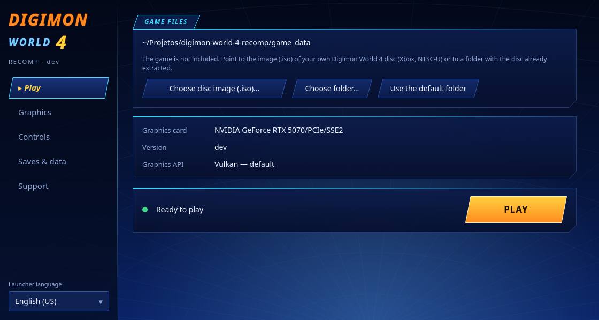
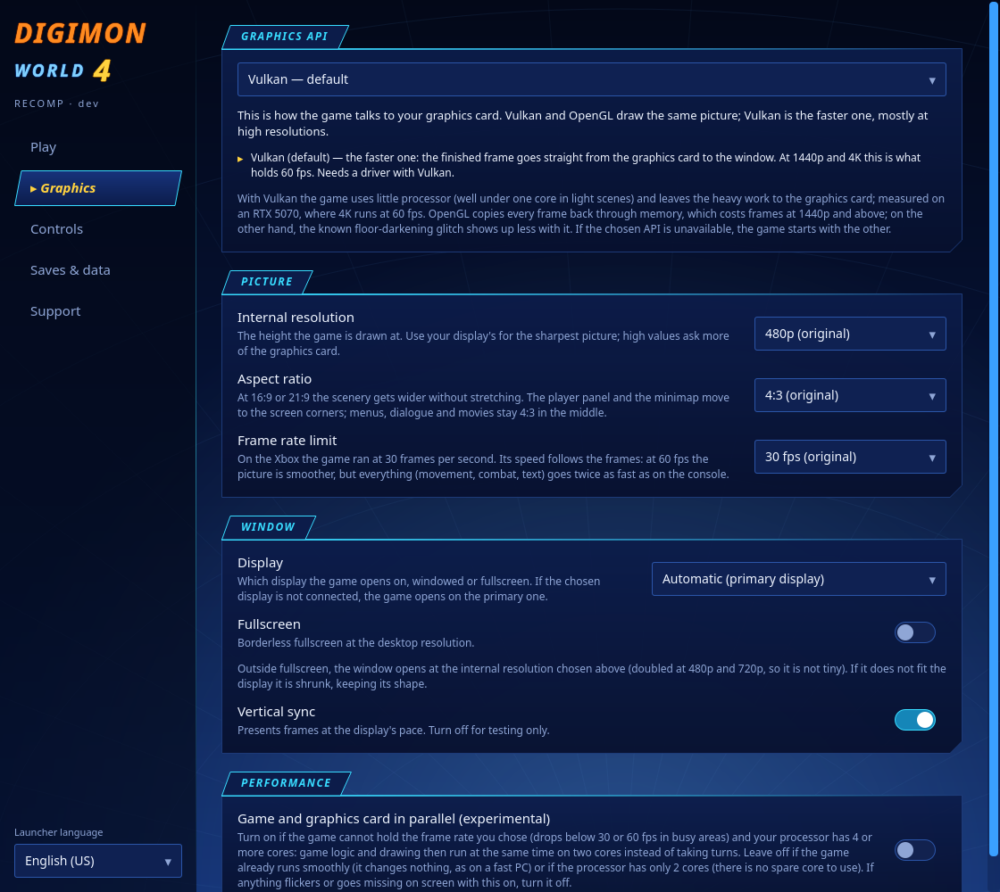

# Digimon World 4 — Recomp

**English** · [Português (Brasil)](README.pt-BR.md)

Experimental **static recompilation of Digimon World 4 (original Xbox, 2005)** into a native
x86-64 program, built on [xboxrecomp](https://github.com/sp00nznet/xboxrecomp).
The game's own code is translated to C once and compiled natively; the xboxrecomp runtime and this
project's code replace the Xbox kernel, GPU, audio and input. No emulator.

> This repository contains **no game code and no game data**. You need your own, legally obtained
> copy of Digimon World 4 for the Xbox (NTSC-U). The C code is generated on your machine from your
> `default.xbe` and is never committed.

> **Runs on Linux and Windows**, with the same launcher, the same two renderers (Vulkan and
> OpenGL) and one download for each system on the
> [releases page](https://github.com/lorransouzaaguiar/Digimon-World-4-Recomp/releases). The macOS
> port has not been started; it is planned.
>
> **Playable and smooth on both systems**, at the same level of performance: excellent on the
> author's computer, which is **the only one it has been tested on** (other graphics cards and
> slower machines are untested). So far it has been played through the first areas: Terminal Area
> (the lobby), Central Area, Death Valley and Humid Cave. Nothing known stops the game from being
> finished, but **it has not been played to the end yet**: later areas, bosses and the ending are
> untested.


## Status

Playable and smooth on Linux and Windows, from boot through the first areas — Terminal Area,
Central Area, Death Valley and Humid Cave — on the one machine it has been tested on (see
[Test machine and results](#test-machine-and-results)). The rest of the game is expected to work
but has not been played yet: expect bugs there.

| Milestone | |
|---|---|
| Pipeline: 23,472 functions lifted, 0 translation errors, 2.25 M lines of C | ✅ |
| Native host for Linux and Windows (SDL2 for window, controller and audio), case-insensitive game file access | ✅ |
| Boot, intro movies (CRI Sofdec), title screen | ✅ |
| Menus, Digimon creation, saving and loading | ✅ |
| OpenGL 3.3 renderer with texture cache: 60 fps in the lobby (CPU renderer ~3 fps, kept as the reference) | ✅ |
| Vulkan renderer, the default: presents straight from the graphics card (swapchain), 4K at 60 fps; OpenGL stays selectable in the launcher (Graphics → Graphics API) and draws the same picture | ✅ |
| Low processor use: about a third of one core in the lobby (it was about two cores) | ✅ |
| Controller (XInput-style pads) and keyboard; the keyboard's keys can be changed in the launcher | ✅ |
| Terminal Area (lobby), tutorial, Central Area, Death Valley and Humid Cave playable | ✅ |
| Every area after those, bosses, the ending | ⬜ not played yet; nothing known blocks it |
| Multiplayer (2–4 players): the game sees four controller ports since v0.5.0 | ⬜ never tried with more than one controller |
| Internal resolution up to 4K and widescreen (16:9, 21:9): wider scenery, player panel and minimap in the screen corners, dialogue box edge to edge, menus stay 4:3 | ✅ played in the first stages |
| Launcher styled after the game's menus, the same on Linux and Windows; frame-rate limit (30 by default, the console's speed; 60 is smoother but the game runs twice as fast) | ✅ |
| Shortcut that quits the game, FPS/CPU/GPU overlay, choice of display (all set in the launcher, since v0.5.0) | ✅ |
| Updates from the launcher (AppImage and Windows `.zip`, since v0.5.0) | ✅ done on Windows 11 (v0.5.1 to v0.5.2); the AppImage's own update has only been run against a test server |
| Linux (AppImage and `.tar.gz`) | ✅ where the port is developed and tested the most |
| Windows 10/11 (`.zip`, since v0.4.0; with the launcher since v0.4.1) | ✅ Vulkan and OpenGL, no DirectX; played on Windows 11: 60 fps at 4K on Vulkan, as on Linux; OpenGL drops to about 40 fps in heavy areas; the automated checks run under Wine |
| macOS | ⬜ planned, not started |
| Steam Deck | ⬜ not tested |

Full details and the list of what is still missing: [STATUS.md](STATUS.md) (Portuguese).

### Test machine and results

Everything in this README was tested on **one** computer. Nothing else has been tried.

| | |
|---|---|
| Graphics card | NVIDIA GeForce RTX 5070, 12 GB (driver 620.73.04) |
| Processor | AMD Ryzen 7 5700X (8 cores / 16 threads) |
| Memory | 32 GB |
| System | CachyOS Linux (Arch-based), kernel 7.3, Wayland session, two displays; Windows 11 on the same computer (dual boot) |

The tables below are from the Linux build. The Windows build reaches the same 60 fps at 4K on
Vulkan; what was tested of it is in [its own section](#windows-build-what-was-tested).

Frame rate, with the limiter off (the game then runs at up to 60 fps, twice the console's speed),
on Vulkan:

| Where | Result |
|---|---|
| Menus, Digimon creation, lobby | 60 fps from 480p to 3840×2160 |
| Central Area and the first stages (the heaviest places tried) | 60 fps at 2560×1440 and at 3840×2160, as played; these areas ran at 34–50 fps before the performance work |
| CPU reference renderer | about 3 fps |

Processor use on the same 92-second run (menus to the lobby, Vulkan, one run each):

| | Before | Now |
|---|---|---|
| 480p 4:3, no window | 195% of one core | 28% of one core |
| 3840×2160 16:9, in a window | 93% of one core, 49 fps | 34% of one core, 60 fps |

Two things changed. The game thread and the emulated-GPU thread used to spin while waiting for the
vertical blank; they now sleep. And with Vulkan the finished frame goes straight from the graphics
card to the window instead of being copied back through memory. OpenGL still copies every frame
back, so it is slower at 1440p and above.

An optional mode (launcher → Graphics → Performance, off by default) runs game logic and drawing
on two cores at the same time instead of taking turns. On the test machine it makes no visible
difference, because the game already holds 60 fps; it is meant for slower processors and has not
been tried on one.

Automated checks (no window, scripted input): the run from boot to the lobby matches the reference
frames on both renderers; the same run passes with a window and the Vulkan swapchain inside a
headless compositor; plugging a virtual controller in and out 400 times while the game reads it
passes. The quit shortcut and the overlay have scripted runs of their own, and the launcher's
updater is tested against a local server standing in for GitHub.

Audio: streamed music and voices used to repeat a third of a second now and then on Linux (the
game's audio threads were missing display refreshes). Fixed in v0.5.1: 4 of 5 scripted runs had
repeats before, 0 of 5 after, and it was confirmed by ear with the AppImage.

Shadows and the floor (v1.0.0): characters had no shadow and the floor went dark for a moment now
and then, because the pass that projects the shadows was drawn with the wrong texture
coordinates. Fixed in both renderers; played on Linux with Vulkan and with OpenGL and on Windows
11 with Vulkan (Central Area and the caves, where it showed the most), and the reference frames
were updated.

Distance fog (v1.0.1): the game keeps a fog on in its 3D scenes and the port did not apply it;
in one boss arena, where it is black, the backdrop came out as a bright rainbow instead of nearly
black. Fixed in both renderers (the fix is shared by them); played on Linux with OpenGL in that
arena, where the backdrop is still somewhat brighter than on the console, and in several other
areas, where the fog looks normal.

Skipping the intro movie (v1.0.0): the game could close when the movie was skipped with START
(about 1 scripted run in 20), a race between two of the game's own threads that the console's
single processor rules out. Fixed: 128 of 128 scripted runs clean on Linux and 16 of 16 under
Wine. The author always skips the movie and has never had this crash, before or after.

### Windows build: what was tested

The Windows build is cross-compiled on Linux (MinGW-w64) and is the same code: same renderers,
same shaders, same widescreen rules.

- **On Windows 11** (same computer, real Windows, not Wine): the game is played there. With
  **Vulkan it holds 60 fps at 4K** (3840×2160), the same as the Linux build. With **OpenGL the
  frame rate dropped to about 40 fps in the heavy areas**; OpenGL copies every frame back through
  memory, which is also why it is the slower one on Linux. Use Vulkan (the default) unless it
  gives you trouble. These are the author's readings while playing, not logged measurements.
- **Under Wine 11.22 on Linux:** automated runs from boot to the lobby match the same reference
  frames as the Linux build, on Vulkan and on OpenGL. Played with a window on Vulkan (lobby,
  Central Area, unlocking Death Valley, the tutorial; up to 1440p 16:9) and briefly on OpenGL.
  Under Wine it ran a little below the Linux build in the heaviest places (about 55 fps in the
  busiest part of Central Area at 1440p, where Linux holds 60).
- **The launcher under Wine:** it opens, its screens draw correctly and the game started from it
  reaches the lobby with the reference frames on both renderers. The display choice was played
  there; the quit shortcut and the overlay passed scripted runs.
- **The launcher on Windows 11** (v0.5.0 to v0.5.2): it opens, finds the graphics card, accepts a
  game folder and shows the project's icon. Its updater found v0.5.1 from v0.5.0, downloaded and
  verified it, and then failed on Windows' 260-character path limit; v0.5.2 repairs that, and
  **the update from v0.5.1 to v0.5.2 was then done there and worked**. Reading an `.iso` and the
  report have not been exercised there.

### Known issues

- At 60 fps the game runs twice as fast as on the console, because its logic advances per frame.
  The default is 30.
- In widescreen the loading screen is stretched to the full width, and the player panel has only
  been checked with one player.
- Windows: if the game hangs, the log does not yet record where each thread stopped (it does on
  Linux); the keyboard as a controller has not been tested there. If an update from the launcher fails,
  download the `.zip` as usual: saves are kept.
- More than one controller has never been tried, and it is unknown whether the game minds the
  empty controller ports (they can be reduced under Controls → Controller ports).
- Closing the game with the window's close button crashed on exit in one automated run inside a
  headless compositor. Nothing is lost if it happens; the quit shortcut does not use that path.
- Tested on a single machine (above). Other GPUs, drivers and distributions are untested; AMD and
  Intel graphics have never been tried.

## Playing a release

One download for your system, nothing to install. The game data is **not** included: it comes
from your own disc.

### Linux

1. Download `DigimonWorld4-Recomp-<version>-x86_64.AppImage` from the [releases page](https://github.com/lorransouzaaguiar/Digimon-World-4-Recomp/releases).
2. Make it executable and open it: `chmod +x DigimonWorld4-Recomp-*.AppImage`, then double-click
   (or `./DigimonWorld4-Recomp-*.AppImage`).
3. On the **Play** screen, choose the image (`.iso`) of your own Digimon World 4 disc, or a folder
   with the disc already extracted. The launcher copies the four game files it needs.
4. Click **PLAY**.

The AppImage carries the launcher (with Qt), the recompiled game and the libraries it needs (SDL2,
libepoxy, libcrypto). It does **not** carry the game data: that comes from your disc.

Requirements: Linux x86-64 with glibc 2.38 or newer (Ubuntu 24.04+, Fedora 39+, Arch, SteamOS 3.6+)
and a GPU with a working OpenGL 3.3 or Vulkan driver (pick the API in the launcher, under Graphics). If the AppImage does not start because FUSE is missing,
run it with `--appimage-extract-and-run`, or use the `.tar.gz` package (same content, unpack and run
`./DigimonWorld4-Recomp`).

Saves, settings and logs live in `~/.local/share/dw4-recomp/`, outside the AppImage, so replacing
the file with a newer version keeps them.

### Windows

1. Download `DigimonWorld4-Recomp-<version>-windows-x86_64.zip` from the [releases page](https://github.com/lorransouzaaguiar/Digimon-World-4-Recomp/releases)
   and extract **all of it** to any folder.
2. Open `DigimonWorld4-Recomp.exe` (the launcher). The first time, Windows may warn that the
   program is unknown (SmartScreen): **More info → Run anyway**.
3. On the **Play** screen, choose the image (`.iso`) of your own Digimon World 4 disc, or a folder
   with the disc already extracted.
4. Click **PLAY**.

The `.zip` carries the launcher (with its own Python and Qt), the recompiled game and the
libraries it needs (SDL2, libepoxy).

Requirements: Windows 10 or 11, 64-bit, and a GPU with a working Vulkan or OpenGL 3.3 driver.

Saves, settings and logs live in `%APPDATA%\dw4-recomp\` (paste that in the Explorer address bar),
outside the extracted folder, so a newer version keeps them. v0.4.0 kept its saves in a
`save_data` folder next to `run.bat`; copy that folder into `%APPDATA%\dw4-recomp\` to keep them.

## Launcher

It is the same on Linux and Windows. In a release it is what the download opens; from a source
checkout:

```bash
./launcher.sh            # opens the launcher
./launcher.sh --play     # starts the game directly with the saved options
```





| Screen | What it does |
|---|---|
| Play | game files: pick a disc image (`.iso`) or a folder; detected graphics card, version, Play button; updates (see below) |
| Graphics | graphics API (Vulkan or OpenGL); internal resolution (480p to 4K), aspect ratio (4:3, 16:9, 21:9) and frame-rate limit (30 or 60); the display the game opens on, fullscreen and vertical sync; the experimental parallel mode |
| Controls | keyboard as controller 1 on/off; shortcuts that quit the game and toggle the FPS/CPU/GPU overlay (keyboard and controller); the key table |
| Saves & data | save folder, list of saves, backup, `.zip` export and import (the current saves are backed up first). Import also takes an Xbox save of the game (a `.zip` with the `UDATA/42410002/` folder, from a console, an emulator or a save site) and signs it again for the port |
| Support | what to try if the game is slow, log folder, a problem report (system, processor, graphics card, options, frame-rate summary) without your home folder's name |

The interface is in Portuguese (Brazil) or English, chosen from the system language; it can be
changed in the sidebar. Every run through the launcher is logged to `logs/` (the last 10 are kept).
Settings are stored in `config/launcher.json`. In a source checkout these folders are in the
project; in a release they are under `~/.local/share/dw4-recomp/` (Linux) or
`%APPDATA%\dw4-recomp\` (Windows).

Releases bundle everything the launcher needs. From a source checkout it uses PySide6 (Qt for
Python), which `scripts/setup.sh` installs into `.venv`; `./run.sh` starts the game without it.
The layout follows the launcher of [hayatog/iss_pc](https://github.com/hayatog/iss_pc); the code is
this project's own.

### Updates

Since v0.5.0 the launcher looks for a newer version in the GitHub releases: when it opens (at most
one request every 6 hours; it can be turned off) or with the **Check for updates** button on the
Play screen.

- **AppImage** (in a folder you can write to) and the **Windows `.zip`**: **Update now** downloads
  the package, checks the size and SHA-256 published in the release, and reopens the launcher on
  the new version. Nothing is installed unless you ask; saves and options stay where they are.
- **Linux `.tar.gz` and source checkouts**: the launcher only tells you and opens the release page.
- **v0.4.1 and earlier** do not have this: download the new package once from the releases page.

How far it has been tested: against a local server standing in for GitHub; under Wine; and on real
Windows 11, where the first update (v0.5.0 to v0.5.1) failed while unpacking, on the 260-character
path limit, and the next one (v0.5.1 to v0.5.2, with the long file names gone from the package)
worked. The AppImage updating itself has only been run against the test server, not with a real
release. If an update fails, nothing is installed and the launcher offers the download page.
The checksum comes from the same release as the package: it guards against a corrupted download,
not a tampered release.

## Game files

You need your own Digimon World 4 Xbox disc, **NTSC-U** (title ID `42410002`). Other regions are
untested. The launcher reads a disc image directly (a game-partition XISO or a full Redump-style
image) and also accepts a folder with the extracted disc. The files it needs sit in the disc root:

```
default.xbe   area.afs   ndmw.afs   ndmw.igb
```

Never share game files, and do not attach them to bug reports.

## Building from source

The build machine is Linux; the Windows build is cross-compiled from it.

Arch / CachyOS:

```bash
sudo pacman -S --needed base-devel cmake ninja clang python sdl2 libepoxy mesa openssl
```

```bash
git clone --recursive https://github.com/lorransouzaaguiar/Digimon-World-4-Recomp.git
cd Digimon-World-4-Recomp
scripts/setup.sh                 # toolkit submodule, local patches, Python environment

# copy your disc contents into game_data/

scripts/regen.sh                 # generates src/recompiled/ from your default.xbe (~3 min)
export PATH=$PWD/.venv/bin:$PATH
cmake -S . -B build -G Ninja -DCMAKE_C_COMPILER=clang
cmake --build build -j$(nproc)
./run.sh
```

Compiling the generated code needs several GB of RAM; lower `-j` if the build runs out of memory.

### Windows build (cross-compiled on Linux)

```bash
sudo pacman -S --needed mingw-w64-gcc shaderc
scripts/build_win.sh             # -> build-win/dw4_recomp.exe (log in build-win/build.log)
```

The script fetches what it needs into `tools/win-deps/` with pinned versions and checksums: SDL2
for MinGW, libepoxy (built from source) and an import library for `vulkan-1.dll` generated from the
Vulkan headers. The result imports no DirectX library. To test it without leaving Linux, with
nothing appearing on the display:

```bash
scripts/soak.py --wine --golden                        # Vulkan, under Wine, against the reference frames
scripts/soak.py --wine --gamescope --opengl --golden   # OpenGL (needs a display: a headless gamescope)
./launcher.sh --wine                                   # the Linux launcher starting the .exe (opens a window)
```

### Release packages

```bash
scripts/package_release.sh vX.Y.Z     # Linux: .AppImage and .tar.gz
scripts/package_win.sh vX.Y.Z         # Windows: .zip (run it after the Linux one)
```

Both write to `dist/`, with one `SHA256SUMS` file for the three downloads, and remove the packages
of other versions from there. They download their packaging tools into `tools/` (appimagetool and
a portable Python to freeze the Linux launcher; the official embeddable Python and Qt for the
Windows one) and refuse to finish if a package contains a game file, a path from the build machine,
a library that needs a glibc newer than 2.38 (Linux), an unexpected DLL import or a path too long
for Windows' 260-character limit (Windows).
The packaged executables contain the recompiled game code; disc data is never included.

## Controls

Any game controller SDL2 recognises works (Xbox, PlayStation and similar pads), on both systems.
The game sees **4 controller ports**, like the Xbox, for local multiplayer with up to 4 players:
controllers take the ports in the order the system reports them (the number of ports can be changed
under **Controls → Controller ports**; without the launcher, `RECOMP_USB_PADS=1..4`).
**Played with one controller; two or more have not been tested yet.**

The keyboard acts as controller 1. The keys below are the defaults and can be changed in the
launcher (**Controls → Keyboard as controller 1**):

| Key | Xbox control |
|---|---|
| Enter | START |
| Backspace | BACK |
| Z / X / C / V | A / B / X / Y |
| Arrow keys | D-pad |
| W A S D | Left stick |
| I J K L | Right stick |
| Q / E | White / Black |
| 1 / 3 | Left / right trigger |
| Shift / Ctrl | Left / right stick click |

### Quitting the game

Fullscreen has no close button. Two shortcuts quit the game, and both can be changed or turned off
in the launcher (**Controls → Quit the game**):

| Where | Default | How it works |
|---|---|---|
| Keyboard | `Ctrl` + `Q` | quits at once; takes 1 to 4 keys together |
| Controller | `Back` + `Start` | held for 1 second, on any controller; 2 to 4 buttons |

Anything not saved inside the game is lost, as when closing the window. Without the launcher:
`DW4_QUIT_KEYS=alt+f4 DW4_QUIT_PAD=lb+rb+start ./run.sh` (`off` turns one off).

### Performance overlay

An overlay in the top-left corner of the screen with **FPS**, **CPU** use and **GPU** use, on both
renderers and at any resolution. `F2` on the keyboard or `L3` + `R3` on the controller show and
hide it; the key, the buttons and "already showing when the game starts" are in the launcher
(**Controls → Performance overlay**).

- **CPU:** average load of all the computer's cores, as in the system monitor (other programs included).
- **GPU:** load of the whole card, not only the game. Read from the NVIDIA driver (NVML) or, on
  Linux, from AMD's `gpu_busy_percent`; on Windows, for other cards, from the system counters. It
  shows `--` when the system does not report it (Intel on Linux, Wine). Checked only on an NVIDIA
  card on Linux; the Windows path has not been tested on real Windows.

Without the launcher: `DW4_OSD=1 DW4_OSD_KEYS=f2 DW4_OSD_PAD=l3+r3 ./run.sh`.

## Reporting a problem

From a release, on either system: in the launcher, open **Support → Create report** and attach the
text file to an issue. It carries the system, the options and the end of the last log. Never attach
game files.

From a source checkout, run with a log and attach the file:

```bash
./run.sh > run.log 2>&1
```

- **Crash:** the log ends with a `[CRASH]` report.
- **Freeze:** wait about ten seconds before closing; after 5 s without a new frame the log records
  where every thread stopped (`[STALL]`; on Windows only the stall itself is recorded for now).
- **Picture problem:** press **F9** with the problem on screen (source builds). It writes a
  screenshot to `build/shots/`; with the OpenGL renderer it also writes a list of every draw call,
  which is what makes most picture bugs findable.
- **Slow:** the launcher's report includes a frame-rate summary of the session.

`DW4_RES=1440 DW4_ASPECT=16:9 ./run.sh` sets the internal resolution (image height) and the aspect
ratio (`16:9` or `21:9`) without the launcher. `DW4_RENDERER=opengl ./run.sh` (or `vulkan`, the
default) picks the graphics API; if the one asked for is unavailable the game falls back to the
other. `DW4_SW_RENDER=1 ./run.sh` runs the CPU reference renderer, to tell a renderer bug from a
game bug. `RECOMP_KICK_AHEAD=1` turns the parallel mode on; `DW4_VSYNC=on|off` picks the
presentation mode on Vulkan.

## For developers

- [STATUS.md](STATUS.md): what works, what is missing.
- [PORT_NOTES.md](PORT_NOTES.md): addresses, hooks, toolkit patches, how each bug was found.
- [docs/REFERENCIAS.md](docs/REFERENCIAS.md): what other ports on the same toolkit do.
- `scripts/soak.py` runs the game without a window from an input script and classifies the result;
  `scripts/golden.py` compares frames against references; `scripts/triage.py` summarises a log.
- `scripts/soak.py --gamescope` runs the same scenario in a window inside a headless gamescope
  (nothing appears on the display), which exercises the Vulkan swapchain.
- CPU profile without `perf`: `scripts/soak.py -e DW4_PROF=/tmp/p.txt -e DW4_PROF_FROM=3900`, then
  `scripts/prof_report.py /tmp/p.txt`.
- `scripts/test_xsave.py` tests the Xbox save import with synthetic saves.
- `scripts/test_updater.py` tests the launcher's updater against a local server (`--online` also
  asks GitHub); `DW4_CRI_TRACE=1` logs when one of the game's audio threads falls behind.
- `scripts/soak.py --wine` runs the Windows build under Wine the same way, and `--wine --gamescope
  --opengl` covers its OpenGL renderer.
- The renderers (`src/hooks/nv2a_vk_backend.c`, `nv2a_gl_backend.c`) hot-reload on Linux: run
  `cmake --build build --target dw4_vk` (or `dw4_gl`) while the game is open. On Windows both are
  linked into the executable.
- What depends on the operating system (paths, environment, crash report) sits behind
  `src/hooks/host_os.h`, with one file for Linux and one for Windows.
- Toolkit changes live in `patches/xboxrecomp-dw4.patch` and are applied by `scripts/setup.sh`.

These documents are in Portuguese for now.

## How it works

The Xbox CPU is an x86, so the game's machine code is lifted function by function to C and
compiled for x86-64. The game talks to the Xbox kernel through 128 imports, which the toolkit
implements on Linux and on Windows; window, controller and audio go through SDL2 on both. It drives the graphics chip (NV2A) by writing command buffers directly; the
toolkit decodes those commands and this project's back end draws them -- OpenGL 3.3 or Vulkan, two
modules behind one interface (`src/hooks/gl_module.h`) -- with the register combiners turned into a
shader and textures cached by guest address and content.

## Credits

- [sp00nznet/xboxrecomp](https://github.com/sp00nznet/xboxrecomp): the recompiler and runtime this
  port is built on.
- Other ports on the same toolkit, studied for ideas on tooling, testing and packaging (no code
  copied): [Amped2-Recomp](https://github.com/bertibertig/Amped2-Recomp),
  [SSX3-Recomp](https://github.com/bertibertig/SSX3-Recomp),
  [SSX3-recomp](https://github.com/koenhendriks/SSX3-recomp),
  [DefJamFFNY-recomp](https://github.com/vyanhursky/DefJamFFNY-recomp),
  [blinx2-recomp](https://github.com/apexJCL/blinx2-recomp).

## Legal

Unofficial fan project, not affiliated with or endorsed by Bandai Namco, Toei Animation or
Microsoft. Digimon World 4 and all related names and artwork belong to their owners. The
screenshots here are shown to document the port; the project license does not cover them.

## License

The code of this project is under the [MIT License](LICENSE). That covers what is in this
repository: the host, the renderers, the launcher, the scripts and the patches.

It does not cover the game. Digimon World 4, its code, data, names and artwork belong to their
owners; nothing of it is in this repository, and the C generated from your `default.xbe` is yours to
keep on your machine, not to redistribute. The xboxrecomp toolkit (a submodule) is MIT, with parts
under LGPL-2.1 derived from xemu; see its `LICENSE`, `NOTICE` and `LICENSES/`.
