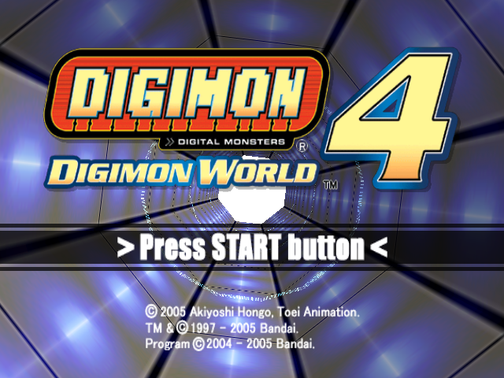
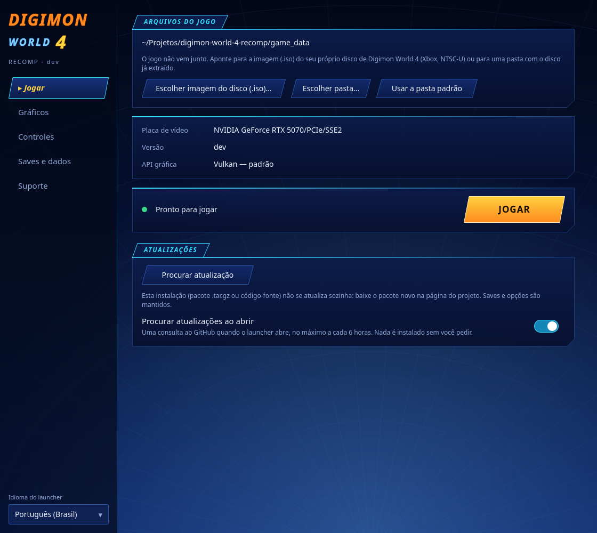
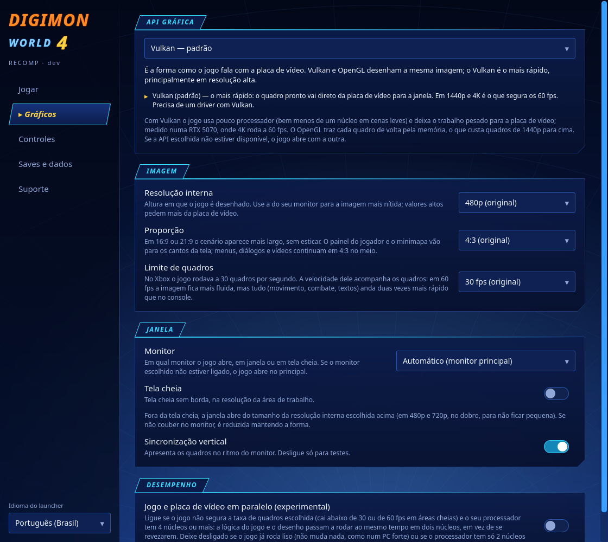

# Digimon World 4 — Recomp

[English](README.md) · **Português (Brasil)**

**Recompilação estática experimental de Digimon World 4 (Xbox original, 2005)** em um programa
nativo x86-64, feito com o [xboxrecomp](https://github.com/sp00nznet/xboxrecomp).
O código do próprio jogo é traduzido para C uma vez e compilado nativamente; o runtime do
xboxrecomp e o código deste projeto substituem o kernel, a GPU, o áudio e a entrada do Xbox.
Não é um emulador.

> Este repositório **não contém código nem dados do jogo**. Você precisa da sua própria cópia,
> obtida legalmente, de Digimon World 4 para Xbox (NTSC-U). O código C é gerado na sua máquina a
> partir do seu `default.xbe` e nunca é versionado.

> **Roda em Linux e Windows**, com o mesmo launcher, os mesmos dois renderizadores (Vulkan e
> OpenGL) e um download para cada sistema na
> [página de releases](https://github.com/lorransouzaaguiar/Digimon-World-4-Recomp/releases). O
> port para macOS não foi começado; está planejado.
>
> **Só o começo do jogo foi testado:** Terminal Area (o lobby), Central Area, Death Valley e Humid
> Cave. Tudo o que vem depois — áreas seguintes, chefes, o final — nunca foi executado.



## Estado

Jogável do boot até as primeiras áreas — Terminal Area, Central Area, Death Valley e Humid Cave —
na única máquina em que foi testado (veja
[Máquina de teste e resultados](#máquina-de-teste-e-resultados)). Inicial e experimental: espere
bugs.

| Marco | |
|---|---|
| Pipeline: 23.472 funções traduzidas, 0 erros de tradução, 2,25 M de linhas de C | ✅ |
| Host nativo para Linux e Windows (SDL2 para janela, controle e áudio), acesso aos arquivos do jogo sem diferenciar maiúsculas | ✅ |
| Boot, vídeos de abertura (CRI Sofdec), tela título | ✅ |
| Menus, criação do Digimon, salvar e carregar | ✅ |
| Renderizador OpenGL 3.3 com cache de texturas: 60 fps no lobby (o de CPU faz ~3 fps e fica como referência) | ✅ |
| Renderizador Vulkan, o padrão: apresenta direto pela placa de vídeo (swapchain), 4K a 60 fps; o OpenGL continua selecionável no launcher (Gráficos → API gráfica) e desenha a mesma imagem | ✅ |
| Pouco uso de processador: cerca de um terço de um núcleo no lobby (eram cerca de dois núcleos) | ✅ |
| Controle (padrão Xbox/XInput) e teclado | ✅ |
| Terminal Area (lobby), tutorial, Central Area, Death Valley e Humid Cave jogáveis | ✅ |
| Todas as áreas depois dessas, chefes, o resto do jogo | ⬜ nunca executado |
| Multijogador (2 a 4 jogadores) | ⬜ ainda não testado |
| Resolução interna até 4K e widescreen (16:9, 21:9): cenário mais largo, painel do jogador e minimapa nos cantos da tela, caixa de diálogo de ponta a ponta, menus em 4:3 | ✅ jogado nas primeiras fases |
| Launcher com visual inspirado nos menus do jogo, igual no Linux e no Windows; limite de quadros (30 por padrão, a velocidade do console; em 60 fica mais fluido, mas o jogo roda no dobro da velocidade) | ✅ |
| Remapear teclas | ⬜ não implementado |
| Linux (AppImage e `.tar.gz`) | ✅ onde o port é desenvolvido e mais testado |
| Windows 10/11 (`.zip`, desde a v0.4.0; com o launcher desde a v0.4.1) | ✅ Vulkan e OpenGL, sem DirectX; o jogo foi jogado no Windows 11; o launcher só foi testado no Wine |
| macOS | ⬜ planejado, não iniciado |
| Steam Deck | ⬜ não testado |

Detalhes e a lista do que falta: [STATUS.md](STATUS.md).

### Máquina de teste e resultados

Tudo o que está neste README foi testado em **um** computador. Nenhum outro foi experimentado.

| | |
|---|---|
| Placa de vídeo | NVIDIA GeForce RTX 5070, 12 GB (driver 620.73.04) |
| Processador | AMD Ryzen 7 5700X (8 núcleos / 16 threads) |
| Memória | 32 GB |
| Sistema | CachyOS Linux (base Arch), kernel 7.3; Windows 11 no mesmo computador (dual boot) |

Todos os números abaixo são do build de Linux. O que foi testado do build de Windows está na
[seção dele](#build-de-windows-o-que-foi-testado).

Quadros por segundo, com o limitador desligado (o jogo então roda a até 60 fps, o dobro da
velocidade do console), em Vulkan:

| Onde | Resultado |
|---|---|
| Menus, criação do Digimon, lobby | 60 fps de 480p a 3840×2160 |
| Central Area e primeiras fases (os lugares mais pesados testados) | 60 fps em 2560×1440 e em 3840×2160, jogando; essas áreas rodavam a 34–50 fps antes do trabalho de desempenho |
| Renderizador de referência em CPU | cerca de 3 fps |

Uso de processador no mesmo percurso de 92 segundos (dos menus ao lobby, Vulkan, uma execução de
cada):

| | Antes | Agora |
|---|---|---|
| 480p 4:3, sem janela | 195% de um núcleo | 28% de um núcleo |
| 3840×2160 16:9, com janela | 93% de um núcleo, 49 fps | 34% de um núcleo, 60 fps |

Duas coisas mudaram. A thread do jogo e a da GPU emulada ficavam girando à espera do retraço
vertical; agora dormem. E, com Vulkan, o quadro pronto vai direto da placa de vídeo para a janela,
em vez de ser copiado de volta pela memória. O OpenGL continua copiando cada quadro, por isso é
mais lento de 1440p para cima.

Um modo opcional (launcher → Gráficos → Desempenho, desligado por padrão) roda a lógica do jogo e
o desenho em dois núcleos ao mesmo tempo, em vez de se revezarem. Na máquina de teste não faz
diferença visível, porque o jogo já segura 60 fps; ele existe para processadores mais fracos e
ainda não foi experimentado em um.

Verificações automáticas (sem janela, entrada por roteiro): o percurso do boot ao lobby confere
com os quadros de referência nos dois renderizadores; o mesmo percurso passa com janela e o
swapchain do Vulkan dentro de um compositor sem tela; plugar e desplugar um controle virtual 400
vezes enquanto o jogo o lê passa.

### Build de Windows: o que foi testado

O build de Windows é compilado no Linux por compilação cruzada (MinGW-w64) e é o mesmo código:
mesmos renderizadores, mesmos shaders, mesmas regras de widescreen.

- **No Windows 11** (mesmo computador): o jogo foi jogado com a v0.4.0, iniciado sem o launcher.
  Funcionou; nenhum número de quadros por segundo foi registrado.
- **No Wine 11.22, no Linux:** rodadas automáticas do boot ao lobby batem com os mesmos quadros de
  referência do build de Linux, em Vulkan e em OpenGL. Jogado com janela em Vulkan (lobby, Central
  Area, liberação do Death Valley, tutorial; até 1440p 16:9) e, por pouco tempo, em OpenGL. No Wine
  ficou um pouco abaixo do build de Linux nos lugares mais pesados (cerca de 55 fps no trecho mais
  cheio da Central Area em 1440p, onde o Linux segura 60).
- **O launcher no Windows** (v0.4.1) só rodou no Wine: abre, as cinco telas são desenhadas certo e
  o jogo iniciado por ele chega ao lobby com os quadros de referência nos dois renderizadores.
  Ainda não foi experimentado em Windows de verdade; as janelas de escolher arquivo, a leitura de
  uma `.iso` e o relatório não foram exercitados de forma alguma.

### Problemas conhecidos

- Pular o vídeo de abertura com START pode fechar o jogo. Nos testes automáticos sem janela
  aconteceu em 2 de 16 execuções; jogando com janela não foi visto. Abra o jogo de novo.
- A geração automática de coordenadas de textura (reflexos, brilhos) não está implementada; alguns
  objetos podem aparecer chapados.
- O chão às vezes escurece por uma fração de segundo em algumas áreas (Central Area, cavernas),
  nos dois renderizadores, menos com OpenGL. É cosmético; a causa ainda não foi encontrada.
- A 60 fps o jogo roda duas vezes mais rápido que no console, porque a lógica dele avança por
  quadro. O padrão é 30.
- Em widescreen a tela de loading fica esticada na largura toda, e o painel do jogador só foi
  conferido com um jogador.
- Windows: se o jogo travar, o log ainda não registra onde cada thread parou (no Linux registra);
  o teclado como controle não foi testado lá.
- Testado em uma única máquina (acima). Outras GPUs, drivers e distribuições não foram testados;
  placas AMD e Intel nunca foram experimentadas.

## Jogar a partir de um release

Um download para o seu sistema, sem instalar nada. Os dados do jogo **não** vêm junto: eles vêm
do seu próprio disco.

### Linux

1. Baixe `DigimonWorld4-Recomp-<versão>-x86_64.AppImage` na [página de releases](https://github.com/lorransouzaaguiar/Digimon-World-4-Recomp/releases).
2. Torne o arquivo executável e abra: `chmod +x DigimonWorld4-Recomp-*.AppImage`, depois dois
   cliques (ou `./DigimonWorld4-Recomp-*.AppImage`).
3. Na tela **Jogar**, escolha a imagem (`.iso`) do seu próprio disco de Digimon World 4, ou uma
   pasta com o disco já extraído. O launcher copia os quatro arquivos de que precisa.
4. Clique em **JOGAR**.

O AppImage traz o launcher (com o Qt), o jogo recompilado e as bibliotecas necessárias (SDL2,
libepoxy, libcrypto). Ele **não** traz os dados do jogo: esses vêm do seu disco.

Requisitos: Linux x86-64 com glibc 2.38 ou mais nova (Ubuntu 24.04+, Fedora 39+, Arch, SteamOS
3.6+) e placa de vídeo com driver OpenGL 3.3 ou Vulkan funcionando (a API é escolhida no launcher, em Gráficos). Se o AppImage não abrir por falta de
FUSE, rode com `--appimage-extract-and-run` ou use o pacote `.tar.gz` (mesmo conteúdo: extraia e
rode `./DigimonWorld4-Recomp`).

Saves, opções e logs ficam em `~/.local/share/dw4-recomp/`, fora do AppImage; trocar o arquivo por
uma versão nova não mexe neles.

### Windows

1. Baixe `DigimonWorld4-Recomp-<versão>-windows-x86_64.zip` na [página de releases](https://github.com/lorransouzaaguiar/Digimon-World-4-Recomp/releases)
   e extraia **tudo** para uma pasta qualquer.
2. Abra `DigimonWorld4-Recomp.exe` (o launcher). Na primeira vez o Windows pode avisar que o
   programa é desconhecido (SmartScreen): **Mais informações → Executar assim mesmo**.
3. Na tela **Jogar**, escolha a imagem (`.iso`) do seu próprio disco de Digimon World 4, ou uma
   pasta com o disco já extraído.
4. Clique em **JOGAR**.

O `.zip` traz o launcher (com Python e Qt próprios), o jogo recompilado e as bibliotecas
necessárias (SDL2, libepoxy).

Requisitos: Windows 10 ou 11, 64 bits, e placa de vídeo com driver Vulkan ou OpenGL 3.3 funcionando.

Saves, opções e logs ficam em `%APPDATA%\dw4-recomp\` (cole isso na barra de endereços do
Explorador), fora da pasta extraída; uma versão nova não mexe neles. A v0.4.0 guardava os saves
numa pasta `save_data` ao lado do `run.bat`; copie essa pasta para `%APPDATA%\dw4-recomp\` para
mantê-los.

## Launcher

É o mesmo no Linux e no Windows. Num release, é o que o download abre; a partir do código-fonte:

```bash
./launcher.sh            # abre o launcher
./launcher.sh --play     # inicia o jogo direto, com as opções salvas
```





| Tela | O que faz |
|---|---|
| Jogar | arquivos do jogo: escolha a imagem do disco (`.iso`) ou uma pasta; placa de vídeo detectada, versão, botão Jogar |
| Gráficos | API gráfica (Vulkan ou OpenGL); resolução interna (480p a 4K), proporção (4:3, 16:9, 21:9) e limite de quadros (30 ou 60); tela cheia e sincronização vertical; o modo paralelo experimental |
| Controles | teclado como controle 1 ligado/desligado, tabela de teclas |
| Saves e dados | pasta dos saves, lista de saves, backup, exportar e importar `.zip` (os saves atuais são guardados antes) |
| Suporte | problemas conhecidos, o que tentar se o jogo estiver lento, pasta de logs, relatório de problema (sistema, processador, placa de vídeo, opções, resumo dos quadros por segundo) sem o nome da sua pasta pessoal |

A interface é em português (Brasil) ou inglês, conforme o idioma do sistema; dá para trocar na
barra lateral. Toda execução pelo launcher é gravada em `logs/` (ficam as 10 últimas). As opções
ficam em `config/launcher.json`. No código-fonte essas pastas ficam no projeto; num release, em
`~/.local/share/dw4-recomp/` (Linux) ou `%APPDATA%\dw4-recomp\` (Windows).

Os releases já trazem tudo de que o launcher precisa. No código-fonte ele usa o PySide6 (Qt para
Python), que o `scripts/setup.sh` instala no `.venv`; o `./run.sh` abre o jogo sem ele.
A divisão de telas segue a do launcher do [hayatog/iss_pc](https://github.com/hayatog/iss_pc); o
código é deste projeto.

## Arquivos do jogo

Você precisa do seu próprio disco de Digimon World 4 para Xbox, **NTSC-U** (title ID `42410002`).
Outras regiões não foram testadas. O launcher lê a imagem do disco diretamente (XISO só da partição
do jogo ou imagem completa estilo Redump) e também aceita uma pasta com o disco extraído. Os
arquivos necessários ficam na raiz do disco:

```
default.xbe   area.afs   ndmw.afs   ndmw.igb
```

Nunca compartilhe arquivos do jogo, nem os anexe a relatos de bug.

## Compilar a partir do código

A máquina de build é Linux; o build de Windows é feito nela por compilação cruzada.

Arch / CachyOS:

```bash
sudo pacman -S --needed base-devel cmake ninja clang python sdl2 libepoxy mesa openssl
```

```bash
git clone --recursive https://github.com/lorransouzaaguiar/Digimon-World-4-Recomp.git
cd Digimon-World-4-Recomp
scripts/setup.sh                 # submódulo do toolkit, patches locais, ambiente Python

# copie o conteúdo do seu disco para game_data/

scripts/regen.sh                 # gera src/recompiled/ a partir do seu default.xbe (~3 min)
export PATH=$PWD/.venv/bin:$PATH
cmake -S . -B build -G Ninja -DCMAKE_C_COMPILER=clang
cmake --build build -j$(nproc)
./run.sh
```

Compilar o código gerado pede vários GB de RAM; diminua o `-j` se faltar memória.

### Build de Windows (compilação cruzada no Linux)

```bash
sudo pacman -S --needed mingw-w64-gcc shaderc
scripts/build_win.sh             # -> build-win/dw4_recomp.exe (log em build-win/build.log)
```

O script traz o que precisa para `tools/win-deps/`, com versões e checksums fixos: o SDL2 para
MinGW, a libepoxy (compilada do código-fonte) e uma biblioteca de importação da `vulkan-1.dll`
gerada dos cabeçalhos do Vulkan. O resultado não importa nenhuma biblioteca do DirectX. Para
testá-lo sem sair do Linux, sem nada aparecer no monitor:

```bash
scripts/soak.py --wine --golden                        # Vulkan, no Wine, contra os quadros de referência
scripts/soak.py --wine --gamescope --opengl --golden   # OpenGL (precisa de uma tela: gamescope sem monitor)
./launcher.sh --wine                                   # o launcher do Linux iniciando o .exe (abre janela)
```

### Pacotes de release

```bash
scripts/package_release.sh v0.4.1     # Linux: .AppImage e .tar.gz
scripts/package_win.sh v0.4.1         # Windows: .zip (rode depois do de Linux)
```

Os dois gravam em `dist/`, com um arquivo `SHA256SUMS` só para os três downloads, e tiram de lá os
pacotes das outras versões. Eles baixam as ferramentas de empacotamento para `tools/` (appimagetool
e um Python portátil para congelar o launcher do Linux; o Python embutível oficial e o Qt para o
de Windows) e se recusam a terminar se um pacote tiver arquivo do jogo, caminho da máquina de
build, biblioteca que peça glibc mais nova que a 2.38 (Linux) ou uma DLL importada fora do previsto
(Windows).
Os executáveis dos pacotes contêm o código recompilado do jogo; os dados do disco nunca vão junto.

## Controles

Qualquer controle que a SDL2 reconheça funciona (Xbox, PlayStation e parecidos), nos dois
sistemas. O teclado age como o controle 1:

| Tecla | Controle do Xbox |
|---|---|
| Enter | START |
| Backspace | BACK |
| Z / X / C / V | A / B / X / Y |
| Setas | Direcional |
| W A S D | Analógico esquerdo |
| I J K L | Analógico direito |
| Q / E | White / Black |
| 1 / 3 | Gatilho esquerdo / direito |
| Shift / Ctrl | Clique do analógico esquerdo / direito |

## Relatar um problema

A partir de um release, em qualquer um dos sistemas: no launcher, abra **Suporte → Criar relatório**
e anexe o arquivo de texto a uma issue. Ele leva o sistema, as opções e o fim do último log. Nunca
anexe arquivos do jogo.

A partir do código-fonte, rode guardando o log e anexe o arquivo:

```bash
./run.sh > run.log 2>&1
```

- **Crash:** o log termina com um relatório `[CRASH]`.
- **Travamento:** espere uns dez segundos antes de fechar; depois de 5 s sem quadro novo o log
  registra onde cada thread parou (`[STALL]`; no Windows, por enquanto, só o travamento em si).
- **Defeito de imagem:** aperte **F9** com o defeito na tela (builds a partir do código). Ele grava
  uma captura em `build/shots/`; com o renderizador OpenGL grava também a lista de todos os draws,
  que é o que permite achar a maioria dos defeitos de imagem.
- **Lentidão:** o relatório do launcher traz um resumo dos quadros por segundo da sessão.

`DW4_RES=1440 DW4_ASPECT=16:9 ./run.sh` define a resolução interna (altura da imagem) e a proporção
(`16:9` ou `21:9`) sem o launcher. `DW4_RENDERER=opengl ./run.sh` (ou `vulkan`, o padrão) escolhe a
API gráfica; se a pedida não estiver disponível o jogo cai na outra. `DW4_SW_RENDER=1 ./run.sh` usa
o renderizador de referência em CPU, para separar bug do renderizador de bug do jogo.
`RECOMP_KICK_AHEAD=1` liga o modo paralelo; `DW4_VSYNC=on|off` escolhe o modo de apresentação no
Vulkan.

## Para quem desenvolve

- [STATUS.md](STATUS.md): o que funciona, o que falta.
- [PORT_NOTES.md](PORT_NOTES.md): endereços, hooks, patches no toolkit, como cada bug foi achado.
- [docs/REFERENCIAS.md](docs/REFERENCIAS.md): o que outros ports com o mesmo toolkit fazem.
- `scripts/soak.py` roda o jogo sem janela a partir de um roteiro de entrada e classifica o
  resultado; `scripts/golden.py` compara quadros com referências; `scripts/triage.py` resume um log.
- `scripts/soak.py --gamescope` roda o mesmo cenário com janela dentro de um gamescope sem tela
  (nada aparece no monitor), o que exercita o swapchain do Vulkan.
- Perfil de CPU sem `perf`: `scripts/soak.py -e DW4_PROF=/tmp/p.txt -e DW4_PROF_FROM=3900` e depois
  `scripts/prof_report.py /tmp/p.txt`.
- `scripts/soak.py --wine` roda o build de Windows no Wine do mesmo jeito, e `--wine --gamescope
  --opengl` cobre o renderizador OpenGL dele.
- Os renderizadores (`src/hooks/nv2a_vk_backend.c`, `nv2a_gl_backend.c`) recarregam a quente no
  Linux: rode `cmake --build build --target dw4_vk` (ou `dw4_gl`) com o jogo aberto. No Windows os
  dois ficam dentro do executável.
- O que depende do sistema operacional (caminhos, ambiente, relatório de crash) fica atrás de
  `src/hooks/host_os.h`, com um arquivo para o Linux e um para o Windows.
- As mudanças no toolkit ficam em `patches/xboxrecomp-dw4.patch` e são aplicadas por
  `scripts/setup.sh`.

## Como funciona

A CPU do Xbox é um x86, então o código de máquina do jogo é traduzido função por função para C e
compilado para x86-64. O jogo conversa com o kernel do Xbox por 128 chamadas importadas, que o
toolkit implementa no Linux e no Windows; janela, controle e áudio passam pela SDL2 nos dois. Ele comanda o chip gráfico (NV2A) escrevendo buffers de comandos
diretamente; o toolkit decodifica esses comandos e o back end deste projeto os desenha -- OpenGL 3.3 ou
Vulkan, dois módulos atrás de uma interface só (`src/hooks/gl_module.h`) --, com
os register combiners convertidos em shader e as texturas guardadas em cache por endereço e
conteúdo.

## Créditos

- [sp00nznet/xboxrecomp](https://github.com/sp00nznet/xboxrecomp): o recompilador e o runtime sobre
  os quais este port é feito.
- Outros ports com o mesmo toolkit, estudados como referência de ferramentas, testes e
  empacotamento (nenhum código copiado):
  [Amped2-Recomp](https://github.com/bertibertig/Amped2-Recomp),
  [SSX3-Recomp](https://github.com/bertibertig/SSX3-Recomp),
  [SSX3-recomp](https://github.com/koenhendriks/SSX3-recomp),
  [DefJamFFNY-recomp](https://github.com/vyanhursky/DefJamFFNY-recomp),
  [blinx2-recomp](https://github.com/apexJCL/blinx2-recomp).

## Aviso legal

Projeto de fãs, não oficial, sem vínculo com a Bandai Namco, a Toei Animation ou a Microsoft nem
endosso delas. Digimon World 4 e todos os nomes e artes relacionados pertencem aos seus
detentores. As capturas de tela estão aqui para documentar o port; a licença do projeto não as
cobre.

## Licença

O código deste projeto está sob a [licença MIT](LICENSE). Ela cobre o que está neste repositório:
o host, os renderizadores, o launcher, os scripts e os patches.

Ela não cobre o jogo. Digimon World 4, seu código, dados, nomes e artes pertencem aos seus
detentores; nada disso está neste repositório, e o C gerado a partir do seu `default.xbe` é para
ficar na sua máquina, não para redistribuir. O toolkit xboxrecomp (um submódulo) é MIT, com partes
sob LGPL-2.1 derivadas do xemu; veja `LICENSE`, `NOTICE` e `LICENSES/` dele.
