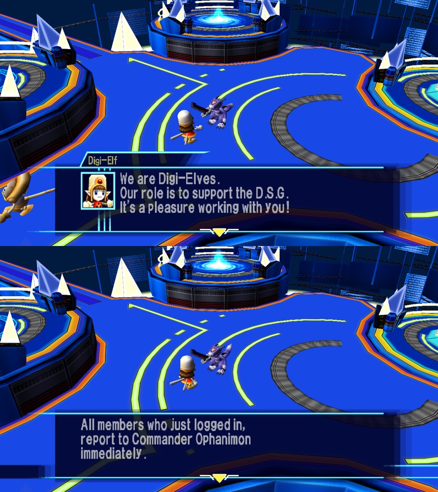
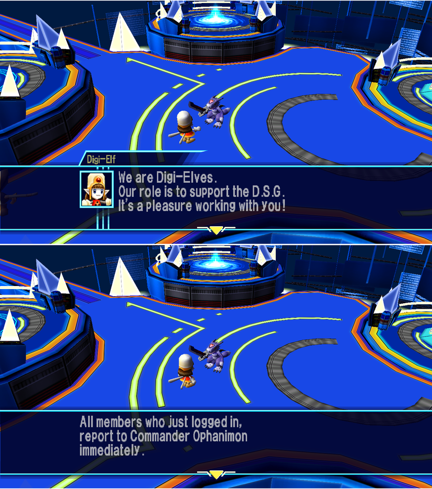

# Caixa de diálogo em widescreen — pedido, varredura, plano e resultado

**Estado (2026-11-24, branch `DW4R-4`): implementado e conferido pelo usuário jogando em 16:9 e 21:9.** A regra está em
`ro_squeeze` (`src/hooks/render_opts.h`) e vale para os dois renderizadores. O que foi feito, o
que mudou em relação ao plano e o que falta estão na seção 9; as seções 1 a 8 são a varredura
original, escrita antes da implementação.

## 1. O pedido (usuário, 2026-11-24)

> "Você é capaz de achar a caixa de diálogo quando o personagem fala com os NPCs sem abrir o jogo?
> Eu preciso que mapeie ela/elas para mim, pois quero fazer igual fizemos com o HUD do personagem,
> preencher de ponta a ponta como é feito no 4:3; hoje não é feito isso no 16:9."

Ou seja: em 4:3 a caixa de diálogo vai de uma borda da tela à outra. Em 16:9 e 21:9 ela fica na
coluna 4:3 do meio e acaba antes das bordas. O objetivo é ela voltar a ir de ponta a ponta em tela
larga, como já foi feito com o HUD.



## 2. Decisão (2026-11-24: opção 1 testada, ficou a opção 2, centralizado)

O fundo e as linhas vão de borda a borda; isso está claro. Falta o usuário escolher onde fica o
**conteúdo** (retrato, nome, texto). A pergunta foi feita e **não foi respondida**:

1. **Ancorado à esquerda (recomendado):** retrato, nome e texto no canto esquerdo, com as mesmas
   margens do 4:3; a seta ▼ continua no centro. É o que foi feito com o HUD.
2. **Centralizado:** o fundo estica, mas retrato e texto continuam na coluna do meio. Muda menos,
   mas sobra um vazio de cada lado dentro da caixa.

## 3. Como reproduzir sem janela

```bash
export PATH=$PWD/.venv/bin:$PATH
scripts/soak.py --scenario tests/scenarios/dialogo.txt --timeout 300 -e DW4_RES=720 -e DW4_ASPECT=16:9
```

- ~102 s. Uma captura por fala em `build/soak/latest/01/shots/X00.bmp` … `X21.bmp`; as marcas
  `d00` … `d21` no log dão o flip de cada uma.
- Flips medidos (variam ±2): `d00` 3946, `d01` 4045, `d10` 4936, `d11` 5035.
- **Tipo A** (fala de NPC, com retrato): `d00`–`d08` e `d12`–`d14`.
  **Tipo B** (mensagem do sistema, sem retrato): `d10`, `d11`. `d09` e `d15` não têm caixa.
  De `d16` em diante é jogo livre, com o HUD.

Duas ferramentas de rastreio, usadas nesta varredura:

```bash
# Lotes (draws já fundidos pelo renderizador) de um ou mais quadros, antes de espremer:
scripts/soak.py --scenario tests/scenarios/dialogo.txt --timeout 300 \
    -e DW4_RES=720 -e DW4_ASPECT=16:9 -e DW4_RO_TRACE=4070,5060
grep "\[ROB\] f4070 " build/soak/latest/01/run.log | grep "rhw 1.00000..1.00000"

# Draw por draw (só o OpenGL grava): captura F9 disparada no segundo dado, sem janela.
scripts/soak.py --opengl --scenario tests/scenarios/dialogo.txt --timeout 300 -e DW4_GL_F9_AT=69
#   -> build/soak/latest/01/shots/f9-000.txt   (69 s = tipo A; 86 s = tipo B)
```

Ler o `f9-000.txt`: linhas `[Q] f<quadro> A n=<ordem> bbox=(x0,y0,x1,y1) zn=(…) tris=… blend=…
tex=<endereço> …`. O `bbox` é em pixels do guest (640×480), antes de qualquer compressão.

## 4. O que foi encontrado

Todo o 2D do jogo chega com `rhw = 1`. Coordenadas abaixo em pixels do guest (tela 0..640 × 0..480).

### 4.1 Lotes (como o renderizador os vê)

Tipo A, flip 4070:

| Lote | Vértices | Caixa (x0,y0 – x1,y1) | O que é |
|---|---|---|---|
| 1 | 6 | 1,1 – 641,481 | quadro de tela inteira (já tratado: não é espremido) |
| 2 | 246 | −54,295 – 695,463 | **painel**: fundo, linhas, moldura do retrato, aba do nome, barrinhas, seta ▼ |
| 3 | 6 | 55,341 – 113,405 | imagem do retrato |
| 4 | 504 | 128,333 – 458,418 | texto da fala |
| 5 | 48 | 66,305 – 122,324 | texto do nome |

Tipo B, flip 5060:

| Lote | Vértices | Caixa | O que é |
|---|---|---|---|
| 1 | 192 | −694,319 – 1335,463 | **painel** (inclui peças deslizantes fora da tela) |
| 2 | 450 | 51,333 – 388,417 | texto da mensagem |

O painel é **um lote só** porque todas as peças usam a mesma textura (o atlas de interface,
`80BC2000` nessa execução — o endereço muda, não usar como chave) e o mesmo estado
(`blend 302,303`). Por isso "não espremer o lote" não serve: esticaria a moldura do retrato e a aba
do nome junto com o fundo.

### 4.2 Peça por peça (captura F9 do OpenGL, tipo A, quadro f4028)

Ordem de desenho de cima para baixo:

| Ordem | Peça | x | y | Triângulos |
|---|---|---|---|---|
| 4119–4134 | seta ▼ de "continuar" (16 draws) | 282 – 359 | 447 – 463 | 1 a 6 cada |
| 4135 | **fundo da caixa** | 1 – 695 | 319 – 462 | 4 |
| 4136 | moldura do retrato (fundo) | 54 – 114 | 340 – 406 | 2 |
| 4137 | moldura do retrato (borda) | 51 – 118 | 336 – 410 | 8 |
| 4138 | aba do nome (parte 1) | 51 – 244 | 299 – 326 | 2 |
| 4139 | aba do nome (parte 2) | 227 – 290 | 299 – 326 | 2 |
| 4140 | aba do nome (contorno) | 48 – 304 | 295 – 326 | 4 |
| 4141–4143 | 3 barrinhas acima do retrato | 84 – 110 | 329 – 336 | 2 cada |
| 4144–4146 | 3 barrinhas abaixo do retrato | 84 – 110 | 410 – 451 | 2 cada |
| 4147 | **linha de baixo** | −54 – 641 | 451 – 454 | 4 |
| 4148 | **linha de cima** | −54 – 641 | 326 – 329 | 4 |
| 4149 | imagem do retrato (textura própria) | 55 – 113 | 341 – 405 | 2 |
| 4150 | texto da fala (textura da fonte) | 128 – 458 | 333 – 418 | 168 |
| 4151 | texto do nome (textura da fonte) | 66 – 122 | 305 – 324 | 16 |

Tipo B (quadro f5016): a seta (4013–4028), o fundo (4029: 1–695 × 319–462) e as duas linhas (4030,
4031: −54–641) são **idênticos** aos do tipo A. A mais: 4032 (−694–1 × 427–455) e 4033/4034
(641–1335, duas linhas) — peças deslizantes paradas fora da tela. O texto é 4035 (51–388 × 333–417).

### 4.3 O que isso quer dizer

- Em 4:3 o fundo (1..695) e as linhas (−54..641) **passam das bordas** da tela (0..640): por isso
  a caixa vai de ponta a ponta no original.
- O fundo tem 694 px de largura e as linhas 695: são as mesmas "tiras" de 694/695 px que o menu
  do START usa (lá: 239..933, 1..695, −54..641). É um componente comum da interface do jogo.
- Em tela larga tudo é espremido em x em torno do centro (÷ 1,333 em 16:9), e a caixa fica de
  ~39 a ~601: acaba antes das bordas.

## 5. Onde mexer e o que já existe

Tudo fica em **`src/hooks/render_opts.h`**, função `ro_squeeze`, chamada no **flush do lote** pelos
dois renderizadores (`flush_pending` em `nv2a_vk_backend.c` e `nv2a_gl_backend.c`). Como o cabeçalho
é comum, a mudança vale para Vulkan e OpenGL de uma vez (regra 3a do `CLAUDE.md`).

`ro_squeeze` hoje, na ordem:

1. recorte estreito (sub-viewport, o minimapa): transforma como um elemento só;
2. lote de tela inteira de profundidade constante (fade do jogo, malha 2D cheia): não espreme;
3. **HUD**: a faixa `-18..659 × 393..485` não é espremida; os lotes 2D seguintes, na "zona" de
   altura da faixa e todos de um lado da tela, são ancorados na borda desse lado; a zona cresce
   com cada lote ancorado;
4. por triângulo: 2D de tela inteira fica; quadro 2D de altura inteira com uv constante é
   alargado; todo o resto é espremido em torno do centro.

A caixa de diálogo cai hoje no item 4 (tudo espremido). Histórico e casos em `PORT_NOTES.md` §7.6.

## 6. Lições do HUD que valem aqui

- **Reconhecer pela geometria exata, não por um critério genérico.** A primeira regra do HUD era
  "lote 2D largo encostado na borda de baixo" e pegou a barra de ajuda do menu do START
  (−54..933 × 366..509), que saiu esticado com os painéis arrancados para o canto. A caixa de
  diálogo **não encosta na borda** (termina em y = 463) e o menu do START usa tiras iguais: o risco
  de confundir os dois é real. Sugestão: reconhecer o fundo por `x = 1..695`, `y = 319..462`
  (±2), 4 triângulos, e as linhas por `−54..641` com 3 px de altura nas alturas 326 e 451.
- **O lote junta peças que precisam de tratamentos diferentes.** O painel tem que ser tratado
  **por triângulo (ou por quadro) dentro do lote**: fundo e linhas esticam; moldura, aba e
  barrinhas acompanham o retrato; a seta fica no centro.
- **Draws seguintes dependem do anterior.** Retrato, texto e nome são lotes separados, desenhados
  depois do painel: a decisão tomada no painel precisa ficar guardada para o resto do quadro (o
  HUD faz isso com `band_frame` + `zone`, comparando `dw4_frame_count()`).
- **A fusão de lotes muda com o conteúdo.** Tipo A e tipo B dão caixas de lote diferentes para o
  mesmo painel (−54..695 e −694..1335). Não usar a caixa do lote inteiro como assinatura.

## 7. Plano sugerido

1. Confirmar com o usuário a opção da seção 2.
2. Em `ro_squeeze`, antes da regra do HUD: se o lote é 2D e contém o fundo da caixa (um quadro
   `1..695 × 319..462`), marcar "diálogo neste quadro" e tratar o lote por quadro:
   - fundo e linhas: alargar até cobrir a tela larga (mapear x0 → 0 e x1 → largura, ou
     simplesmente não espremer, já que passam das bordas);
   - seta ▼ (x 282..359, y 447..463): espremer em torno do centro, como hoje;
   - moldura, aba e barrinhas (x < 320): ancorar à esquerda (`x' = x / wide`) — ou espremer no
     centro, se o usuário escolher a opção 2.
3. Para os lotes seguintes do mesmo quadro que caem na altura da caixa (y entre ~295 e ~463):
   retrato, texto e nome ancorados à esquerda (opção 1) — atenção: o **texto cruza o centro**
   (128..458), então a condição "todo de um lado" do HUD não serve aqui.
4. Tipo B: mesmas peças de fundo e linhas; só o texto (51..388) para ancorar.
5. Testar: `dialogo.txt` em 16:9 e 21:9 nos dois renderizadores (olhar `X01` e `X11`);
   `scripts/soak.py --golden` e `--opengl --golden` (4:3 não pode mudar); o menu do START em 21:9
   não pode voltar a quebrar (cenário: terminar os diálogos e apertar `enter`).

## 8. O que não foi visto

- Outros tipos de caixa: lojas, perguntas com escolha, o menu vermelho do portal ("Commander
  Room"), falas nas fases. O roteiro não chega a eles; para esses é preciso uma captura F9 do
  usuário **no OpenGL** (só ele grava a lista de draws), em `build/shots/`.
- Falas com mais de 3 linhas, ou com retrato do lado direito, se existirem.
- 2 a 4 jogadores.

## 9. Resultado (2026-11-24)



- **Feito.** Fundo e linhas de borda a borda. Moldura do retrato, aba do nome,
  barrinhas, seta ▼, retrato, nome e texto ficam na coluna 4:3 do meio (**opção 2**).
- **A opção 1 (conteúdo à esquerda) foi implementada, o usuário jogou e pediu a 2.** O texto não
  aproveita a largura extra — continua quebrando no mesmo lugar — e sobrava um vazio só à
  direita. As quebras de linha estão escritas no texto do jogo (`\r\n` em UTF-16 no `area.afs`,
  uma string por página); não há largura de quebra para alargar. Refluir o texto exigiria
  reescrever as falas.
- **21:9: a mesma regra, conferida só pelo usuário jogando** ("tá legal"). Ele primeiro pediu
  para não mexer em 21:9; aprovado o 16:9, pediu o mesmo lá e dispensou o teste sem janela.
- `DW4_WS_DIALOG=0` desliga a regra, para comparar antes e depois.

O que saiu diferente do plano da seção 7:

- **Cada tira são dois quadros**, não um: o que cobre a tela e a sobra de 54 px que em 4:3 fica
  fora dela (fundo 1..641 + 641..695; linhas −54..1 + 1..641). "Largo = tira" não basta: a sobra
  era espremida para dentro da tela e deixava uma faixa mais escura. Tira é o triângulo largo
  **ou o que divide uma aresta com um triângulo de tira**.
- **A caixa entra deslizando** (fundo da esquerda, −694 → 1; linhas da direita; 17 quadros). A
  assinatura "fundo em 1..695" da seção 6 falhava nesses quadros. Agora o fundo é reconhecido
  pela forma (640 × 143 em y 319..462 com a sobra de 54 colada), em qualquer x.
- Com o conteúdo no centro, os lotes seguintes (retrato, fala, nome) não precisam de regra.

Verificado sem janela, Vulkan e OpenGL, 720p 16:9, no lobby: tipos A e B parados, a entrada do
tipo B deslizando, o menu do START e o HUD iguais a antes; goldens 4:3 iguais. **Confirmado pelo
usuário jogando (2026-11-24, 16:9):** testou a versão centralizada em alguns personagens — "tá bom
assim". **Falta** o que a seção 8 lista (lojas, escolhas, menu do portal, fases, 2–4 jogadores).
